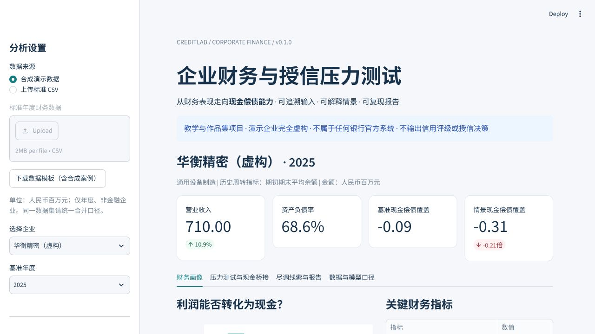

# CreditLab · 企业财务与授信压力测试

**把“有利润”与“有钱还债”的差异讲清楚。** 一个面向公司金融学习与作品展示的Python项目：从年度财务数据出发，观察盈利、营运资金和债务结构，模拟压力情景，并生成可追溯的分析备忘录。

Python 3.12 · Streamlit · Plotly · MIT · 纯Python计算内核

> 本项目不属于任何银行或金融机构，不使用内部数据或银行评级方法。默认数据为3家虚构企业的12个年度观察值（2022—2025），不对应真实企业。不构成授信审批、评级或投资建议。



## 解决什么问题

一个企业收入增长、利润为正，仍可能因回款变慢、存货占用和债务集中到期面临现金压力。CreditLab把这些因素放进同一条可解释的现金桥接，让分析结果可以回到原始数据和假设，而不止是一串财务比率。

| 功能 | 可以展示的能力 |
|---|---|
| CSV校验、单位与口径说明 | 财务数据清洗、勾稽检查、异常处理 |
| 盈利、杠杆、流动性与现金转换周期 | 公司金融及营运资金分析 |
| 收入、毛利率、周转天数和利率冲击 | 情景分析与现金偿债思维 |
| 现金瀑布图和双因素敏感性矩阵 | Python数据可视化与结果解释 |
| 规则提示、尽调问题和Markdown备忘录 | 将数据分析转化为业务沟通 |
| 独立计算内核、测试与CI | 可维护性、复现与边界验证 |

## 快速运行

安装Python 3.12并在仓库根目录运行：

```bash
python -m venv .venv
# Windows PowerShell:
.venv\Scripts\Activate.ps1
# macOS / Linux:
# source .venv/bin/activate
python -m pip install -r requirements.txt
python -m streamlit run app.py
```

若PowerShell禁止激活脚本，直接执行`.venv\Scripts\python.exe -m pip install -r requirements.txt`和`.venv\Scripts\python.exe -m streamlit run app.py`即可，不必改变系统执行策略。

浏览器打开终端显示的本地地址，选择企业与年度，调整侧栏情景；第三个标签页导出报告。需要在开发机运行Python服务，GitHub仓库本身不会自动运行Streamlit。

**只生成报告：计算内核不依赖第三方包。**

```bash
python -m creditlab --input data/demo_financials.csv --company "华衡精密（虚构）" --year 2025 --output reports/credit_memo.md
```

CLI默认情景：收入下降10%、毛利率下降2个百分点、回款延长15天、利率上升100基点、50%存量债务重定价、现金税率近似25%。可以用`--revenue-drop 0.2`与`--dso-extra 30`修改两个参数；完整参数在网页端或Scenario对象中设置。

## 演示案例

- **华衡精密（虚构）**：收入增长、回款占用扩大，观察利润与经营现金流的背离。
- **澄远商贸（虚构）**：相对稳定的商贸经营，用作同一冲击下的比较案例。
- **锦川材料（虚构）**：周期下行、利润收缩、债务增长，观察资本密集业务的现金压力。

数据由[scripts/generate_demo.py](scripts/generate_demo.py)确定性生成；它们是教学观察值，不是完整三张报表或实证样本。真实企业应用请按[数据字典](docs/data_dictionary.md)记录公开年报来源、页码与调整口径。

## 方法与验证

```text
标准财务CSV → 输入与勾稽校验 → 财务指标
                            → 情景假设 → 营运资金与利润变化
                                       → 经营现金流 → 本息覆盖与资金缺口
                                       → 尽调问题 + 可追溯报告
```

- [公式、模型假设和局限](docs/methodology.md)
- [字段口径与导入说明](docs/data_dictionary.md)
- [五分钟演示、面试追问及诚实的作品集表述](docs/demo_guide.md)
- [生成的示例备忘录](docs/sample_memo.md)

```bash
python -m pip install -r requirements-dev.txt
python -m pytest -q
```

测试包括独立手算现金桥接、零冲击还原、利息不重复扣除、回款冲击、会计恒等式、异常输入、缺失值、零分母、跨年口径和应用交互；GitHub Actions在push及PR时运行。测试通过只说明所测逻辑满足断言，不代表模型经真实信用风险回测。

## 结构

```text
app.py                     Streamlit展示层
creditlab/engine.py        数据结构、校验、比率、压力测试和提示
creditlab/io.py            严格CSV读取
creditlab/report.py        可复算Markdown报告
creditlab/__main__.py      无第三方依赖的命令行入口
data/                     合成数据模板
docs/                     方法、字段、案例报告与演示说明
scripts/generate_demo.py   可复现数据生成
tests/                    核心逻辑与应用测试
.github/workflows/ci.yml   自动化检查
```

## 使用边界与后续方向

自设提示阈值未进行行业校准，不输出评级、PD或额度；现金缺口不能直接转换为贷款建议。模型不假设自动续贷，不覆盖外汇、担保链或完整月度资金预算。详见方法文档。

应用不把上传内容写入文件或共享缓存；若部署云端，上传数据会传给云服务。仓库仅发布合成数据与公开资料整理，不纳入实习机构内部文件或客户数据。AI工具辅助编写了初版代码和文档，使用者应理解并验证公式，按实际贡献展示。

欢迎通过Issue提供可复现问题、附手算结果的测试或有出处的财务口径修正。计划方向：公开年报案例、月度现金预算、行业阈值校准；这些尚未实现。

## 许可

代码和项目自建合成数据使用[MIT许可证](LICENSE)。第三方学习资料的权利归各自权利人。
